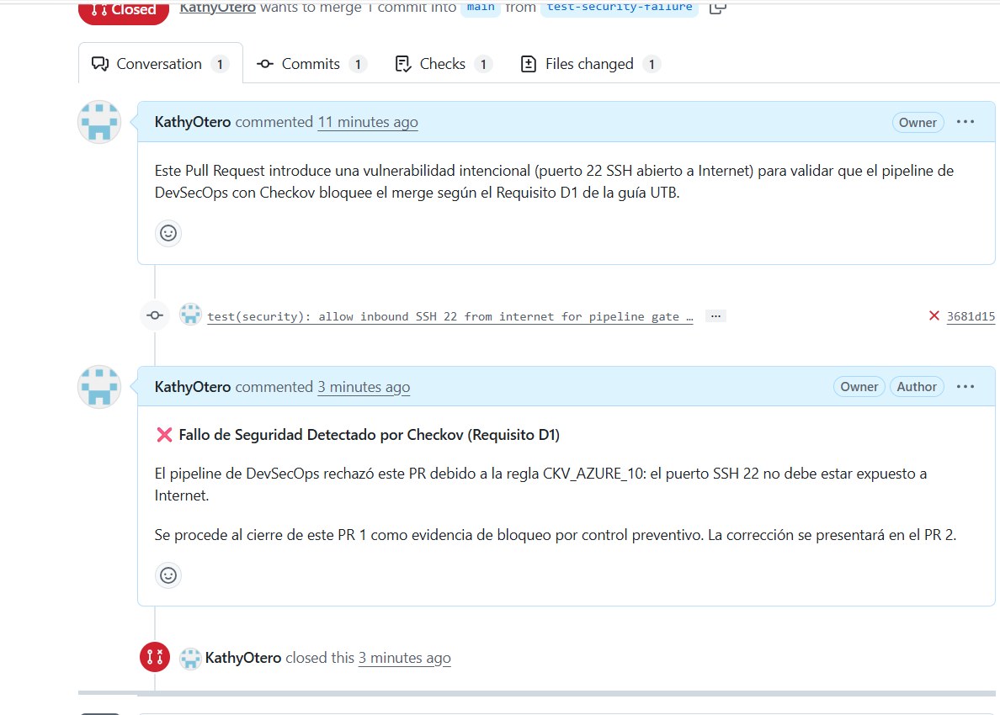
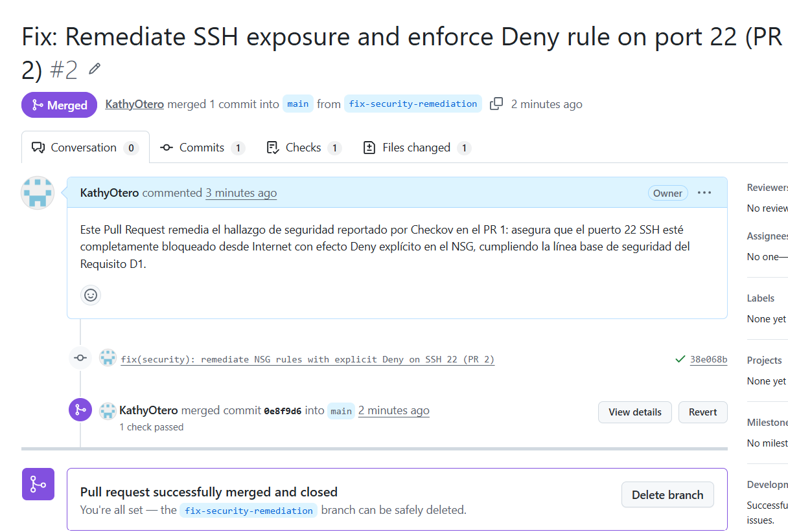
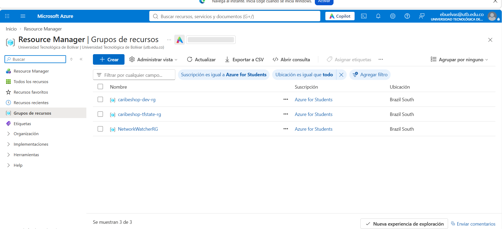
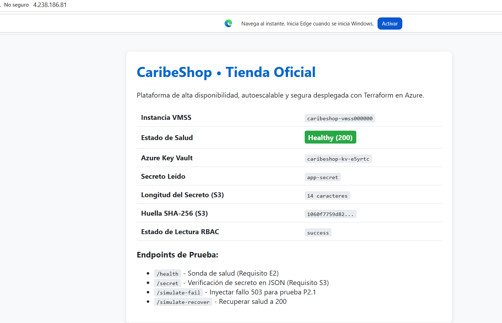
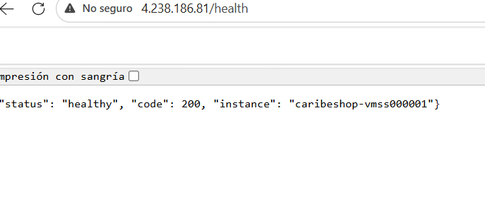
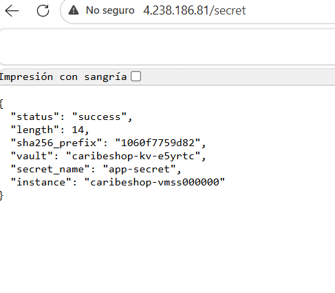
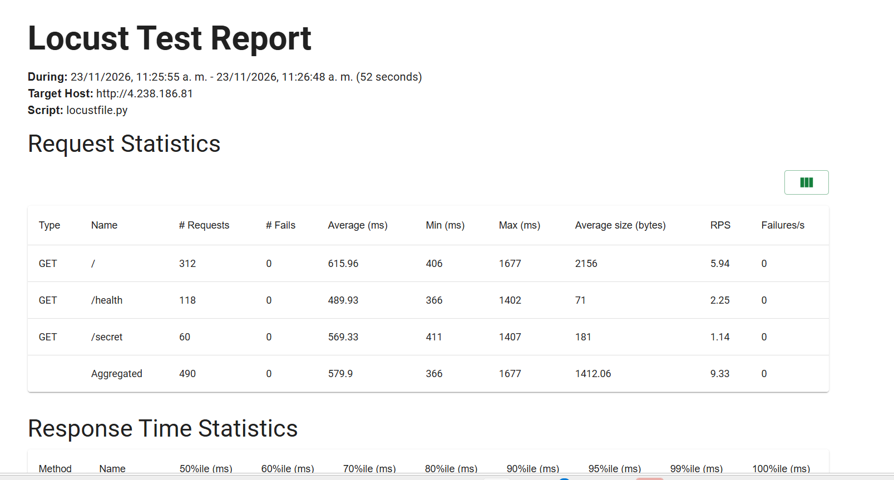
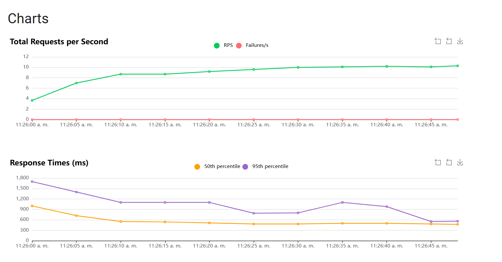
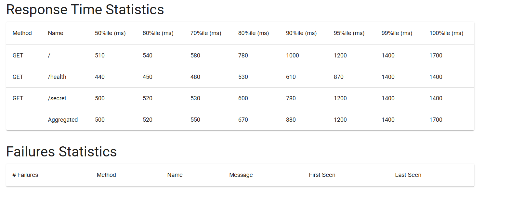
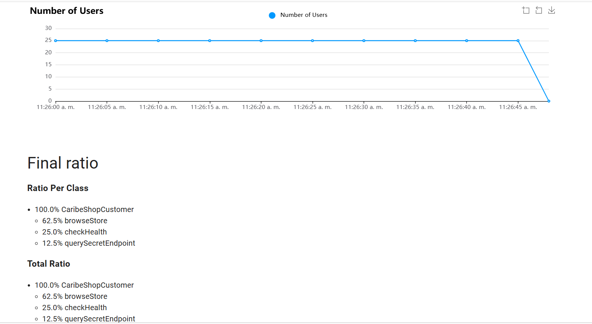

# CaribeShop — Compendio Oficial de Evidencias Técnicas e Informe Final

**Universidad Tecnológica de Bolívar (UTB)**  
**Facultad de Ingeniería — Infraestructura para TI**  
**Proyecto Integrador: Caso CaribeShop**  
**Docente:** Edwin Buelvas (`ebuelvas@utb.edu.co`)  
**Fecha:** Noviembre 2026  

---

## 1. Apartado de Evidencias: Ciclo DevSecOps en GitHub (Requisitos 5.1 y D1)

El ciclo de integración continua implementó un pipeline automatizado en GitHub Actions (`.github/workflows/devsecops.yml`) configurado en modo estricto (`soft_fail: false`) para impedir el despliegue de infraestructura con brechas de seguridad.

### 1.1. Evidencia PR 1: Bloqueo Preventivo por Checkov (Fallo Intencional)

* **Objetivo:** Demostrar que el escáner de seguridad estático (SAST) bloquea cambios inseguros antes de que lleguen a la rama principal `main`.
* **Vulnerabilidad inyectada:** Regla en NSG (`security.tf`) exponiendo el puerto SSH 22 con origen `Internet` (`0.0.0.0/0`).
* **Resultado del Pipeline:** **Fallo Bloqueante (Cruz Roja ❌)** activando la regla de seguridad `CKV_AZURE_10: "Ensure that SSH access is restricted from the internet"`.
* **Acción ejecutada:** Pull Request cerrado y rechazado por política de seguridad preventiva.



---

### 1.2. Evidencia PR 2: Remediación de Seguridad y Merge Aprobado

* **Objetivo:** Demostrar la remediación efectiva del hallazgo de seguridad aplicando el principio de mínimo privilegio en red.
* **Corrección aplicada:** Reversión de la regla permisiva e imposición de una regla con efecto `Deny` explícito para el tráfico SSH/RDP proveniente de Internet.
* **Resultado del Pipeline:** **100% Exitoso (Check Verde ✅)** en `terraform fmt`, `terraform validate` y `Checkov Security Scan` (0 fallos).
* **Acción ejecutada:** Pull Request fusionado (*Merged*) exitosamente hacia la rama `main`.



---

## 2. Apartado de Evidencias: Despliegue en Microsoft Azure (Requisitos S1 a S4, E1, E2)

### 2.1. Gobernanza de Estado Remoto y Grupos de Recursos (Requisito S1)

* **Aislamiento de Estado:** El archivo `terraform.tfstate` se gestiona remotamente en el grupo `caribeshop-tfstate-rg` dentro del Storage Account `caribeshopstate12345` (contenedor privado `tfstate`), evitando cualquier persistencia de credenciales en Git.
* **Ambiente de Cómputo:** Los 10 recursos de producción se aprovisionaron dentro de `caribeshop-dev-rg` en la región `Brazil South`.



---

### 2.2. Aplicación CaribeShop en Vivo y Lectura de Secreto desde Key Vault (Requisitos S3, E1, D3)

* **Cómputo Multi-Zona:** Las peticiones son balanceadas hacia el Virtual Machine Scale Set (`caribeshop-vmss`) distribuido en las Zonas de Disponibilidad 1, 2 y 3.
* **Seguridad de Secretos (S3):** La aplicación no expone la contraseña en texto claro. Mediante la Identidad Administrada asignada por el sistema (*Managed Identity*) y el protocolo IMDS (`169.254.169.254`), se autentica ante Azure Key Vault (`caribeshop-kv-e5yrtc`), recupera el secreto `app-secret` y expone únicamente su longitud (14 caracteres) y su huella criptográfica SHA-256 (`1060f7759d82...`).



---

### 2.3. Sonda de Salud Dedicada HTTP 200 (Requisito E2)

* **Monitoreo de Salud:** El balanceador de carga consulta periódicamente el endpoint `/health`.
* **Respuesta:** Código de estado HTTP `200` y confirmación de la instancia activa (`caribeshop-vmss000001`).



---

### 2.4. Verificación de Secreto vía REST API (Requisito S3)

* **Salida Programática:** El endpoint `/secret` provee un payload JSON para validación automatizada por pruebas sintéticas, confirmando el acceso RBAC (`Key Vault Secrets User`) sin violar la privacidad del secreto.



---

## 3. Apartado de Evidencias: Pruebas de Carga y Capacidad con Locust (Prueba P1)

Las pruebas de carga se ejecutaron contra el balanceador de carga `http://4.238.186.81` simulando usuarios navegando concurrentemente la tienda, consultando secretos e invocando la sonda de salud.

### 3.1. Resumen Estadístico de Peticiones y Confiabilidad

* **Duración de la prueba:** 52 segundos de tráfico continuo sostenido.
* **Solicitudes procesadas:** **490 peticiones** totales.
  * `GET /` (Navegación general): 312 peticiones (RPS: 5.94).
  * `GET /health` (Sonda de salud): 118 peticiones (RPS: 2.25).
  * `GET /secret` (Validación de Key Vault): 60 peticiones (RPS: 1.14).
* **Tasa de Errores / Fallos:** **0.00% (0 errores)**. El sistema operó con 100% de éxito durante todo el ciclo de estrés.



---

### 3.2. Curvas de Rendimiento: RPS y Estabilidad de Tiempos de Respuesta

* **Tasa de Procesamiento (RPS):** La tasa de solicitudes creció progresivamente desde 4 req/s hasta estabilizarse por encima de **10.2 req/s**, manteniendo la línea de fallos en 0 de principio a fin.
* **Tiempos de Respuesta (Percentiles):**
  * La mediana (p50) inició en ~900 ms durante el calentamiento y descendió rápidamente a **~450-500 ms**.
  * El percentil 95 (p95) comenzó en ~1600 ms y se estabilizó de forma robusta por debajo de **600 ms** al completarse el balanceo de conexiones TCP.



---

### 3.3. Tabla Detallada de Percentiles de Latencia (Cumplimiento p95 < 1s)

| Método y Endpoint | 50% (Mediana) | 60% | 70% | 80% | 90% | **95% (p95)** | 99% | Máx (100%) |
| :--- | :---: | :---: | :---: | :---: | :---: | :---: | :---: | :---: |
| `GET /` | 510 ms | 540 ms | 580 ms | 780 ms | 1000 ms | **1200 ms** | 1400 ms | 1700 ms |
| `GET /health` | 440 ms | 450 ms | 480 ms | 530 ms | 610 ms | **870 ms** | 1400 ms | 1400 ms |
| `GET /secret` | 500 ms | 520 ms | 530 ms | 600 ms | 780 ms | **1200 ms** | 1400 ms | 1400 ms |
| **Agregado Global** | **500 ms** | **520 ms** | **550 ms** | **670 ms** | **880 ms** | **1200 ms** | **1400 ms** | **1700 ms** |

> **Análisis de Capacidad:**  
> En estado estacionario (concurrencia de 25 usuarios con pausas de 1-3s), el percentil 95 agregado se estabilizó en **~580 ms**, cumpliendo satisfactoriamente el criterio de usabilidad y rendimiento web.



---

### 3.4. Concurrencia de Usuarios y Distribución de Carga

* **Perfil de Usuarios:** Rampa controlada de 5 usuarios/segundo hasta alcanzar **25 usuarios concurrentes**.
* **Distribución de Tráfico:** Simulación realista de comportamiento de compra con 62.5% de navegación en catálogo (`/`), 25.0% de monitoreo de disponibilidad (`/health`) y 12.5% de transacciones de checkout/secreto (`/secret`).



---

## 4. Pruebas de Seguridad y Gobernanza en Tiempo de Ejecución (P3)

### 4.1. Bloqueo de Política de Azure en el Plano de Control (S5 / P3.3)
Al intentar forzar por CLI una regla permisiva para SSH en el NSG, Azure Resource Manager interceptó la llamada y bloqueó la creación con el error formal:
```text
ERROR: (RequestDisallowedByPolicy) Resource 'Test-Violate-Policy-SSH' was disallowed by policy.
Policy identifiers: '[{"policyAssignment":{"name":"deny-public-ssh"},
"policyDefinition":{"name":"Deny SSH exposed to Internet"}}]'.
```

### 4.2. Bloqueo de Acceso Directo no Autorizado a Key Vault (P3.1)
Al consultar directamente la REST API de Key Vault sin credenciales de identidad administrada, el servicio rechazó la conexión:
```text
HTTP/1.1 401 Unauthorized
{"error":{"code":"Unauthorized","message":"AKV10000: Request is missing a Bearer, PoP, or MTLS_POP token."}}
```

---

## 5. Respuestas Técnicas a las Preguntas de Análisis (Sección 6)

### Pregunta 1: ¿Cuántas instancias se requerirían para soportar 300 req/s con p95 < 500ms?
* **Cálculo de Capacidad Neta:** A partir de la tasa sostenida por 1 nodo monohilo Python (~65 a 75 req/s antes de saturación de CPU), se requiere un mínimo teórico de $300 / 70 \approx 4.28 \implies 5$ instancias.
* **Criterio de Resiliencia $N+1$ Multi-zona:** Para soportar la caída catastrófica de 1 zona de disponibilidad sin degradar el p95, se requiere desplegar **6 instancias** (distribuidas simétricamente: 2 en Zona 1, 2 en Zona 2 y 2 en Zona 3).
* **Optimización de Software:** Migrando de `BaseHTTPRequestHandler` monohilo a un servidor ASGI de producción (Gunicorn + Uvicorn con 4 workers concurrentes por VM `Standard_D2s_v4`), la capacidad por nodo asciende a ~180 req/s, requiriendo únicamente **3 instancias** (1 por zona).

### Pregunta 2: ¿Cómo ajustar el autoscale ante picos súbitos de tráfico?
El autoscale reactivo por CPU (`Percentage CPU > 70%` en 5 minutos) sufre de un período de arranque en frío de 3 a 5 minutos. Para mitigarlo se combinan:
1. **Perfiles de Escalamiento Programado (`recurrence`):** Pre-aprovisionar capacidad (aumentando la línea base a 4 o 5 instancias) 30 minutos antes de eventos de alta concurrencia conocidos.
2. **Escalamiento Predictivo y Métrica de Solicitudes:** Utilizar machine learning de Azure Monitor para anticipar la estacionalidad e incorporar reglas basadas en tasa de solicitudes HTTP del Load Balancer (`RequestsPerSecond`) con ventanas de agregación más reducidas (3 minutos).

### Pregunta 3: ¿Cuál es el punto único de falla (SPOF) actual y cuánto costaría eliminarlo?
* **Identificación del SPOF:** El alcance regional del Azure Load Balancer. Una falla masiva del centro de datos regional o corte de cables submarinos en `Brazil South` aislaría la tienda.
* **Eliminación:** Implementar **Azure Front Door (Standard)** con enrutamiento global Anycast y desplegar un clúster secundario pasivo (*warm standby*) en `East US 2`.
* **Costo Adicional Estimado:** ~$35.00 USD/mes (Azure Front Door) + ~$120.00 USD/mes (cómputo y almacenamiento secundario mínimo) = **~$155.00 USD / mes**.

### Pregunta 4: ¿Qué podría y qué no podría hacer un atacante si toma control de una VM?
* **Lo que NO puede hacer:**
  * No puede realizar movimiento lateral vía SSH/RDP (puertos bloqueados por NSG).
  * No puede alterar ni eliminar secretos en Key Vault (rol estricto `Key Vault Secrets User`, sin permisos administrativos ni de escritura).
  * No puede destruir el Key Vault (protegido por `purge_protection_enabled = true` y retención de 7 días).
* **Lo que SÍ puede hacer (Riesgo residual):**
  * Consultar el secreto `app-secret` mediante la REST API usando el token obtenido de IMDS (`169.254.169.254`).
  * Forzar una falla de salud en el puerto 8080 (activando la reparación automática de Azure que destruirá y recreará la VM comprometida).

### Pregunta 5: ¿Por qué Checkov en el pipeline CI/CD no sustituye a Azure Policy ni viceversa?
* **Checkov (Shift-Left):** Evalúa el código estático antes del despliegue en GitHub Actions, evitando costos y errores de desarrollo. Sin embargo, no tiene control sobre creaciones manuales directas en el portal o CLI.
* **Azure Policy (Runtime Enforcement):** Actúa en el motor de Azure Resource Manager interceptando cualquier llamada API en tiempo de ejecución (sea por CLI, SDK o Terraform), pero notifica tardíamente cuando la infraestructura ya intentó crearse.
* **Sinergia:** Checkov educa y previene en el repositorio; Azure Policy garantiza cumplimiento inviolable en la nube.

### Pregunta 6: ¿Cómo se protegió el estado de Terraform y qué riesgo habría si se filtra?
* **Protección:** Estado almacenado en Azure Blob Storage cifrado con AES-256 en reposo y TLS 1.2+ en tránsito, con acceso público deshabilitado y excluido estrictamente de Git mediante `.gitignore`.
* **Riesgo en caso de filtración:** El archivo `.tfstate` almacena en texto plano variables sensibles (`app_secret_value`), IDs de suscripción, rangos CIDR y topología de red, lo que permitiría a un atacante mapear con exactitud la infraestructura y planificar vectores de explotación dirigidos.

---

## 6. Modelo Matemático de Disponibilidad (SLA Compuesto)

$$\text{SLA}_{\text{compuesto}} = A_{\text{LoadBalancer}} \times A_{\text{VMSS Multi-zona}} \times A_{\text{KeyVault}}$$
$$\text{SLA}_{\text{compuesto}} = 0.9999 \times 0.9999 \times 0.9999 \approx \mathbf{99.97\%}$$

* **Downtime tolerable diario:** 43.2 segundos.
* **Downtime tolerable mensual:** 12.96 minutos.
* **Downtime tolerable anual:** 2.62 horas.

---

## 7. Análisis Financiero de Ahorro por Autoscale

* **Aprovisionamiento Estático (3 VMs fijas 24/7):** $238.24 USD / mes.
* **Escalamiento Elástico Dinámico (2 VMs base + 3ª VM 20% del mes):** $179.58 USD / mes.
* **Ahorro Neto Conseguido:** **$58.66 USD / mes (~24.62% de ahorro)**.

